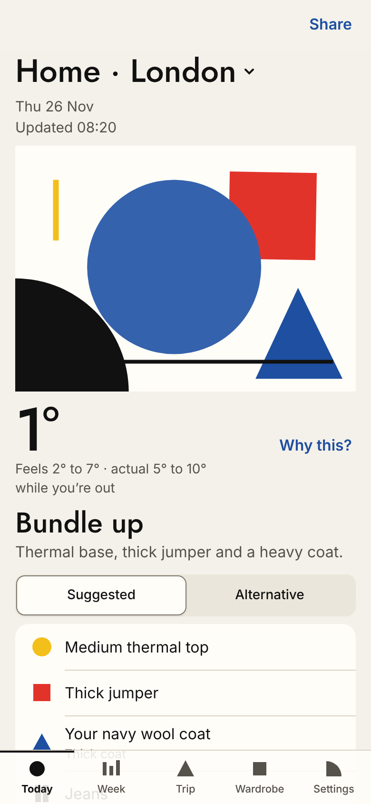
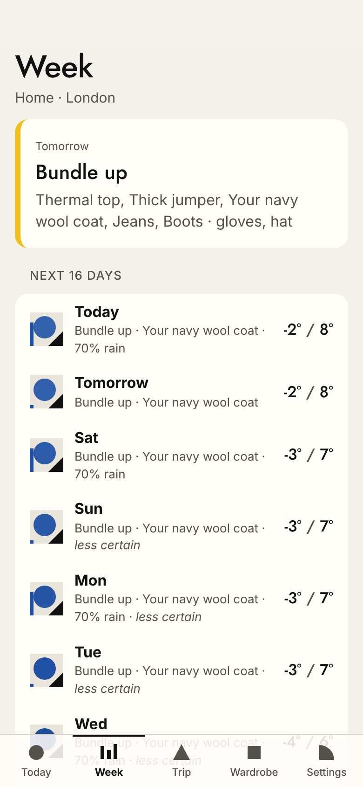
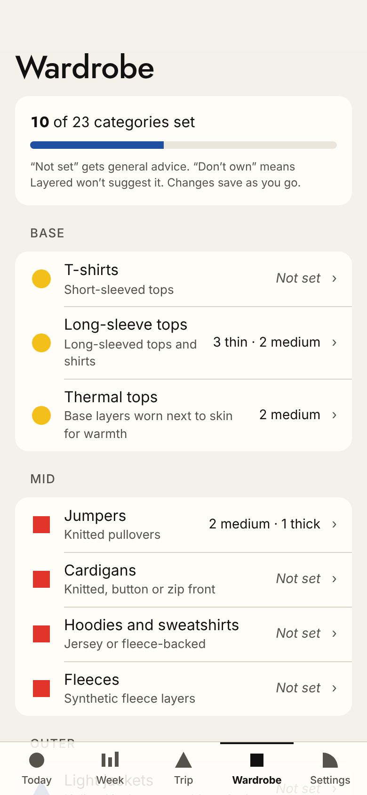

# Layered

Layered turns your local forecast into what to wear, from the clothes you actually own. It tells you which layers to put on, whether to take an umbrella or gloves, and what to pack for a trip. A morning nudge can tell you before you get dressed. It's a free web app you install on your phone. It has no accounts, no ads and no tracking.

**Live:** https://layered-a9i.pages.dev

<p align="center">
  
  
  
</p>

## Features

- **Today.** A verdict, the layers to wear and extras to bring, for the hours you'll be out. Tap **Why this?** to see the working. Rain timing, gust warnings, air quality and pollen come with it, and so does an "Updated HH:MM" time.
- **Your own clothes.** Record how many of each kind of garment you own, by thickness, with optional insulation, water and wind resistance, material and a nickname. Advice uses only what you have, offers an alternative combination, and says what's missing.
- **How you feel the cold.** Choose "feel the cold", "average" or "run warm" and add a few preferences. Rate the day in the evening ("too cold", "just right", "too warm") and Layered adjusts gradually.
- **Activities, commute and routines.** Nine activities, including office day and staying in, with an effort level for running, cycling and hiking. Your commute legs are compared. Saved routines, such as the school run, make Today dress you for the coldest of them.
- **Week.** 16 days, each with its verdict. Days far ahead are marked as less certain. Open any day for the full outfit.
- **Trips.** Add one or more destinations with dates. You get one packing list across every stop. Days within 16 days use the forecast, and later days use typical weather.
- **Notifications.** A morning outfit, an optional evening preview of tomorrow, and at most one alert a day if the advice changes. They arrive at your local time.
- **Sync.** Link devices with a 10-character code. You don't need an account.
- **Share.** Share the day as a poster image.
- **Your data.** Export and import as JSON. **Delete my data** wipes this device and any server copies.
- **Works offline.** The app shell is cached, and the last good forecast is shown with its time. If Open-Meteo is down, MET Norway takes over.
- **Light and dark themes, °C or °F, 12 or 24-hour time.**

See [CHANGELOG.md](CHANGELOG.md) for what changed in each release and [docs/requirements.md](docs/requirements.md) for the full backlog and its status.

## Install on your phone

- **iPhone or iPad (Safari):** open the site, tap **Share**, then **Add to Home Screen**.
- **Android (Chrome):** open the site, open the **⋮** menu, then tap **Install app**.

On iPhone and iPad, notifications only work once Layered is on your Home Screen, on iOS or iPadOS 16.4 or later. Open it from the Home Screen icon, then turn notifications on in **Settings → Notifications**.

## How it decides

Layered looks at the hours you'll be outside and takes the coldest *feels-like* temperature in that window. It adjusts for what you're doing (cycling feels colder, running warmer) and for how you feel the cold. Then it picks a band:

| Dress for | Wear |
|---|---|
| 22° and up | T-shirt |
| 17–22° | T-shirt, light layer optional |
| 12–17° | Two light layers |
| 7–12° | Base layer, jumper, jacket |
| 2–7° | Base layer, jumper, warm coat |
| below 2° | Thermal base, thick jumper, heavy coat |

The band becomes a set of requirements: how much insulation, wind protection, rain protection, footwear, and layers you can take off later. Layered matches them to the clothes you've recorded, picking thicknesses that meet the target without overdoing it. Then come the extras: umbrella or waterproof, gloves, hat, scarf, sunglasses, sunscreen, reflective kit, and a warning when it's gusty.

The engine is plain TypeScript in `src/engine`. It runs the same on your phone, in the tests and in the notification Worker. See [docs/architecture.md](docs/architecture.md) for how the pieces fit together.

## Privacy

- Your wardrobe, comfort profile, ratings, routines, trips and settings stay on your device.
- "Use my location" is only asked for when you tap it. It's rounded to about 1 km and kept on the device.
- The forecast comes straight from Open-Meteo using rounded coordinates. If Open-Meteo is down, the request goes through Layered's server to MET Norway.
- Sync and notifications are opt-in. Sync stores your data under your code. Notifications store your push address, rounded coordinates, time zone and comfort settings, but not your wardrobe.
- No accounts, analytics, ads or third-party scripts. The server stores only a salted hash of your IP address, briefly, for rate limiting.

The full breakdown of what leaves the device is in [docs/architecture.md](docs/architecture.md#privacy-boundaries).

## Local development

You need Node 22.

```sh
npm ci
npm run dev          # the app on http://localhost:5173
npm run typecheck
npm run lint
npm test             # unit tests (Vitest)
npm run build        # production build in dist/
npm run test:e2e     # builds, then runs the Playwright smoke test against dist/
```

The first time you run the end-to-end test, install Chromium with `npx playwright install chromium`. The test mocks Open-Meteo and every `/api` route, so it never calls a real service. To refresh the screenshots above, run `SCREENSHOTS=1 npm run test:e2e`.

`npm run dev` serves the app only. To run the Pages Functions with a local D1 as well:

```sh
cp .dev.vars.example .dev.vars        # add VAPID keys if you want /api/push/key to answer
npm run build

# create the local tables once
sed "s/LAYERED_DB_ID/layered-db/" worker/wrangler.toml > worker/wrangler.deploy.toml
npx wrangler d1 migrations apply layered-db --local --config worker/wrangler.deploy.toml --persist-to .wrangler/state
rm worker/wrangler.deploy.toml

npx wrangler pages dev dist --d1 DB=layered-db
```

Never commit `.dev.vars`. It's in `.gitignore`.

## Deployment and self-hosting

Every push to `main` deploys through GitHub Actions. The workflow runs the tests, deploys `dist/` and `functions/` to Cloudflare Pages, applies the D1 migrations and deploys the `layered-push` Worker. Pull requests run typecheck, lint, unit tests and the end-to-end smoke test.

To run your own copy on Cloudflare's free plan, follow [docs/self-hosting.md](docs/self-hosting.md). It covers the Pages project, the D1 database and its bindings, the Worker, secrets, and a least-privilege API token for CI.

### Notifications

Morning, evening and change-alert notifications come from the `layered-push` Worker in `worker/`. It runs every 15 minutes, reads subscriptions from D1 and sends Web Push messages signed with a VAPID key pair.

### Rotating the VAPID keys

1. Generate a new pair: `npx web-push generate-vapid-keys`. It prints a public key and a private key, both base64url.
2. Set the Worker secrets, pasting each value at the prompt rather than on the command line:
   ```sh
   npx wrangler secret put VAPID_PUBLIC_KEY --config worker/wrangler.toml
   npx wrangler secret put VAPID_PRIVATE_KEY --config worker/wrangler.toml
   ```
3. Set the same public key as `VAPID_PUBLIC_KEY` in the Pages project's production environment variables, then redeploy the site so `/api/push/key` serves it.
4. Existing subscriptions are bound to the old public key, so push services reject them. Each device has to turn notifications off and on again to resubscribe with the new key.

Don't keep the private key anywhere else once it is set.

## Contributing

Issues and pull requests are welcome. Read [CONTRIBUTING.md](CONTRIBUTING.md) for setup and conventions, and [docs/process.md](docs/process.md) for how the team works in Sprints and what "done" means.

## Licence

Layered is free software under the [GNU Affero General Public License v3.0 or later](LICENSE) (AGPL-3.0-or-later). If you run a modified copy for other people, the AGPL requires you to offer them its source. That's why the app's **Settings → About** links to this repository. If you host your own changes, point that link at your fork.

### Credits

- Weather data by [Open-Meteo.com](https://open-meteo.com/), under [CC BY 4.0](https://creativecommons.org/licenses/by/4.0/).
- Fallback weather data from [MET Norway](https://api.met.no/), under [CC BY 4.0](https://creativecommons.org/licenses/by/4.0/).
- [Jost](https://github.com/indestructible-type/Jost) typeface by Owen Earl, under the [SIL Open Font License](https://openfontlicense.org/).

— torrentsec
