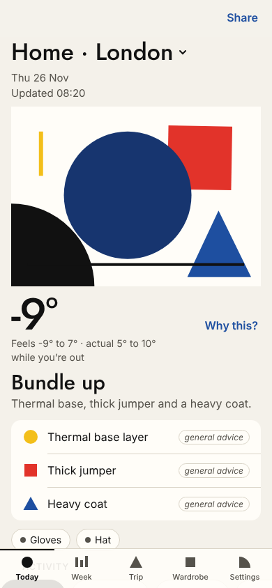
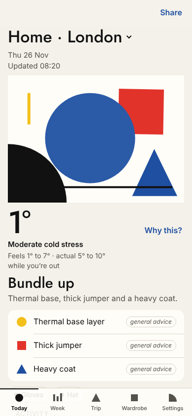
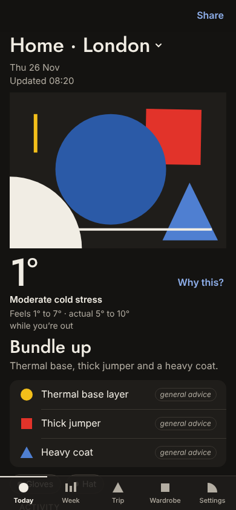
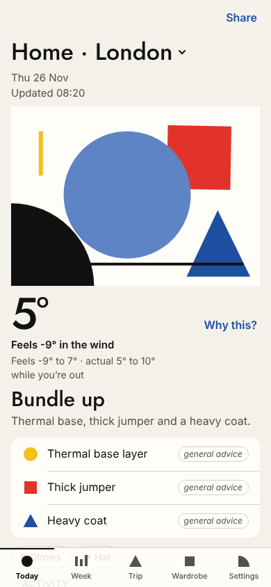
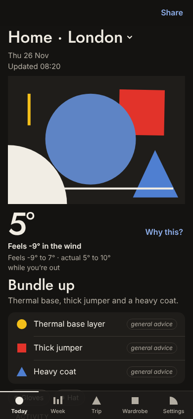

# Sprint 7: calibrating the feels-like headline (#84)

**Shipped in Sprint 8 (#93):** real temperature first is now the default hero, with the circle coloured by how it feels (UTCI), a range line that gives only the air range (so the feels number is not repeated), and the hourly strip keeping UTCI with the real temperature beneath. The familiar wind-chill number and the `feels-familiar` and `feels-actual` flags are removed. Simple bands are unchanged.

Paired with dev-06, whose refinements are folded in: say the UTCI stress category in words, use the JAG/TI wind chill as the "other apps" number, and check that the clothing target does not move.

## Question

Since Sprint 6 the hero shows UTCI. On the test forecast's London morning it reads "−9°" while the air is 5°, and other apps say about 1°. The number is right (see the Sprint 6 Review), but people will compare. Can we keep the honest number and still stop the "−9° vs 5°" shock, without changing the advice?

## What we tried

Two wordings behind flags, next to today's hero. Production is unchanged: with no flag the hero is exactly as before.

| Flag | Big number | Line under it | Range line |
|---|---|---|---|
| none (today) | UTCI, "−9°" | none | Feels −9° to 7° · actual 5° to 10° |
| `?flags=feels-familiar` | Wind chill, "1°" (apparent temperature above 10 °C or in calm air) | UTCI category in words, "Moderate cold stress" | Feels 1° to 7° · actual 5° to 10° |
| `?flags=feels-actual` | Air temperature, "5°" | "Feels −9° in the wind" (or "in the sun", or no reason when neither is clear) | unchanged |

- `src/data/feels-calibration.ts`: `windChill` (JAG/TI, as the Met Office, Environment Canada and the US National Weather Service publish it, null above 10 °C or under 4.8 km/h), `familiarFeels`, `familiarRange`, `calibratedReading` and `feelsTrial`. It reuses `heroReading`, `STRESS_LABEL`, `RADIANT_MENTION` and `fmtTemp`.
- `src/components/CalibratedFeels.tsx` draws the readout for a flagged wording; `DayView` picks it only when a flag is on.
- Flags come from dev-06's shared `flagOn` (`src/data/flags.ts`); this spike adds two names.
- With `feels-familiar` the hourly strip shows wind chill too, so the screen never shows two kinds of feels-like at once.

Screenshots at 390 px, London, the test forecast at 08:20:

| | Light | Dark |
|---|---|---|
| Today (no flag) |  | |
| Familiar number |  |  |
| Real temperature first |  |  |

## Evidence

**The gap, at the same hour** (`feels-calibration.test.ts`, rounded °C; "review" is the Sprint 6 Review's case, the rest are the six golden days):

| Case | Air | UTCI | Wind chill | Open-Meteo apparent |
|---|---|---|---|---|
| Review: 5°, 25 km/h, overcast | 5 | −11 | 1 | −1 |
| London: 3°, 25 km/h, showers | 3 | −13 | −2 | −4 |
| Oslo: −10°, 15 km/h, overcast | −10 | −24 | −17 | −16 |
| 8°, 30 km/h, overcast | 8 | −6 | 4 | 1 |
| 8°, calm, clear noon | 8 | 19 | n/a | 6 |
| 15°, light wind, clear | 15 | 22 | n/a | 13 |

- In wind, UTCI sits 7 to 12° below wind chill. In sun it sits 9 to 13° above apparent temperature, because UTCI counts the sun and the others don't. So the gap goes both ways, and no fixed offset closes it.
- Wind chill matches Environment Canada's published chart on five checked points.

**The advice doesn't move.** The engine dresses from the IREQ clothing target, not the hero number. The spike only reads finished advice and a test checks it never changes it. All 1,709 unit tests and the 6 browser tests pass with the flags off.

**What each wording costs:**
- *Familiar number.* It agrees with other apps, but the hero then shows a number the engine never used. "Why this?" still opens with "it will feel like −9°", and it shows 1° with "Moderate cold stress" under it. Wind chill also ignores sun, so on the clear 8° day the hero would say 6° while the model says 19°. That's the same kind of false precision people complain about (voice of customer, signal 8).
- *Real temperature first.* Every app agrees on 5°. The UTCI number stays on screen, and the line names a reason for the gap. It matches "Why this?" and US-069 (real temperature next to feels-like). The range line repeats "−9°" just under the note, which is a bit much.

Not yet done: the PO's blind read of the three wordings. The flags are ready for it at Review.

## Recommendation

**Keep "real temperature first"** (`feels-actual`), and **drop the familiar number.**

Real temperature first takes away the shock without hiding or contradicting the model. The familiar number swaps one disagreement (with other apps) for a worse one (with our own "Why this?"), and it is wrong in sunshine. Put "Moderate cold stress" in words in "Why this?" instead, where it already sits.

Backlog item if kept: the hero shows the air temperature, with "Feels X° in the wind/sun" under it. Open points:
- Should the circle's colour follow the air temperature (as in the prototype) or UTCI?
- The range line should stop repeating the note.
- The share poster and notifications should use the same wording.
- The minus sign should be a true minus (−), as elsewhere in the docs.

Size S.
