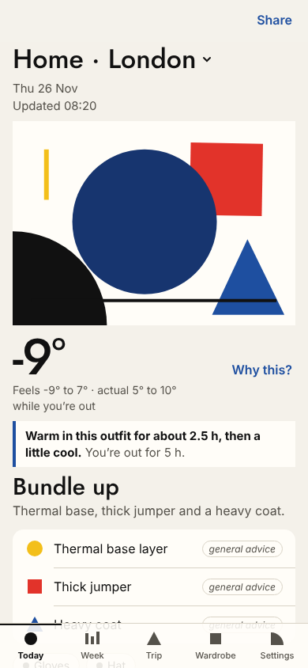
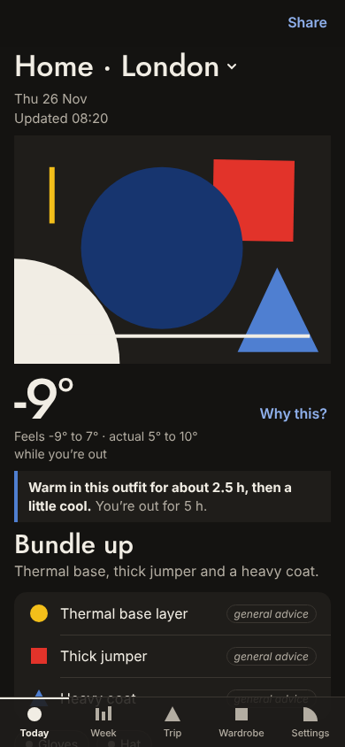

# Feels like in what you wear (#85)

Sprint 7 innovation item. Branch `spike/85-feels-in-clothes`, behind the `feels-in-clothes` flag (open the app with `?flags=feels-in-clothes`; `?flags=` turns it off). Production behaviour doesn't change.

## Question

A feels-like temperature asks people to turn a number into clothes themselves, and UTCI's number reads much harsher than other apps' (Sprint 6 Review: "Feels like −9°" with an actual 5°). Can we say instead how long the outfit we suggest keeps you warm, from the model we already run, and would that line be more useful and easier to trust than any temperature?

## What we tried

- **Engine.** `comfortTime()` (`src/engine/science/comfort-time.ts`) runs the ISO 11079 Duration Limited Exposure, which the clothing target already uses, the other way round: given the outfit's basic insulation, how long until you start to feel cool (`DLE_neutral`) and until the cold is more than mild discomfort (`DLE_min`). It uses the same inputs as the clothing target (shared through `ireqParamsFor()` in `target.ts`, not copied), takes the hour that runs out first, gives a rider no more time than a walker, and counts the personal bias as insulation the person lacks.
- **Outfit.** The ISO 9920 sum of the matched layers when they can be summed (`ScienceWhy.outfit`), else the band's own plan, which is what generic advice stands for.
- **Wording.** `feelsInClothes()` (`src/data/feels-in-clothes.ts`) gives one of three lines under the feels-like readout on Today and the Week day view. Times are rounded down, so the line never promises warmth the model doesn't give. It stays silent for the simple bands and on warm days, where the question is overheating.

| Case | Line | Small print |
|---|---|---|
| Warm the whole time | Warm enough in your coat for your 30 min out. | Good for about 60 min in all. |
| A little cool by the end | Warm in this outfit for about 2.5 h, then a little cool. | You’re out for 5 h. |
| Cold before you're back | Warm in your heavy coat for about 20 min, then cold. | You’re out for 60 min. Add a layer or warm up indoors partway. |

The tone is in the words; the coloured edge only repeats it. The copy went through a UX-writing review: it leads with the trip ("for your 30 min out") instead of "all day", and the cold line dropped a second number to stay under 20 words.

 

Test forecast (cold, showery London, 5 h walk, nothing in the wardrobe): "Warm in this outfit for about 2.5 h, then a little cool." No horizontal overflow at 390 px.

## Evidence

The Sprint 5 golden days through the default path (`src/state/golden-days.test.ts`, "feels like in what you wear"), walking, no bias, full wardrobe:

| Day | Out | Target / matched outfit (clo) | Warm for | Line |
|---|---|---|---|---|
| Cloudy 8 °C, 30 km/h | 30 min | 1.38 / 1.41 | 65 min | covered |
| London 3 °C, showers | 30 min | 1.38 / 1.17 | 28 min | a little cool |
| London | 1 h | 1.62 / 1.48 | 46 min | a little cool |
| London | 4 h | 2.05 / 1.48 | 46 min | cold (bearable 2.7 h) |
| Oslo −10 °C | 30 min | 1.65 / 1.59 | 28 min | a little cool |
| Oslo | 1 h | 2.14 / 1.59 | 28 min | cold (bearable 44 min) |
| Mild 15 °C, sunny 8 °C | any | under 0.8 / 0.88 | over 8 h | covered |
| Madrid 28 °C | any | heat ladder | — | no line |

1. **The model is consistent.** An outfit at exactly the clothing target is warm for the whole time outside on every cold golden day, walking and cycling, 30 min to 4 h (a test checks all 24 cases). The line and the target come from one equation, so they can't disagree about the weather.
2. **The line shows a gap the verdict hides.** Matching still works from band plans, not clo (thermal-model §9.1). On the London golden day the matched layers sum to 1.17 clo against a 1.38 target, so the honest line for our own suggestion is "a little cool" after about 20 minutes. For long trips the heaviest plan (bundle, about 1.6 clo) can't reach targets of 2 clo and more, and the line says to add a layer. Today none of this shows.
3. **Wording.** Three lines, each under 20 words, no unit people have to learn. The answer people want first ("am I warm for this trip?") comes first.
4. **Not tested.** No one outside the team has read the lines; votes on the device were not replayed against them (the stored votes have no worn clo yet).

Limits: whole-body only, so hands, feet and face are not counted (ISO 11079 covers local cooling; we don't run it); wet clothing is not counted in the DLE, so a showery day reads a little kind; DLE is a heat-loss limit for an average adult, not a promise; commute and routine advice uses the colder leg's hours with the total time outside.

## Recommendation

**Keep, after one change.** The line is honest and plain, and it answers what people ask. But it must not ship while matching can suggest an outfit below its own target: a line that calls our own advice "a little cool" would cost trust rather than earn it. Proposed backlog items, in order:

1. Match garments on clo instead of band plans (thermal-model §9.1), so the suggested outfit reaches the target and the line normally reads "Warm enough … for your 30 min out".
2. Then ship the line under the feels-like readout for science users. Show the cold case only when the wardrobe really can't reach the target, as a limitation ("Your warmest coat gives about 40 min today").
3. Run a blind read alongside #84's calibrated number before choosing whether the line sits beside the number or replaces it.

The flag helper `src/data/flags.ts` is worth keeping for future innovation Sprints.
