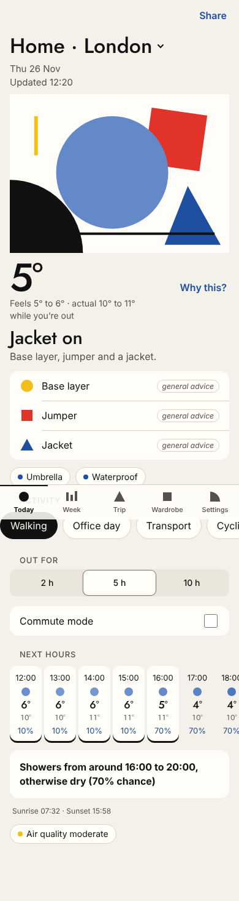
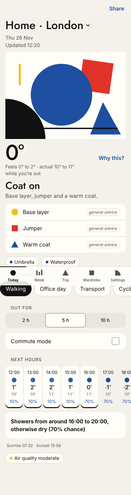

# Site exposure: open, city street, mostly shade (#86)

Spike branch `spike/86-site-exposure`. Production doesn't change: no caller sets a site, so every place, saved or new, is still the open site the model has always assumed.

## Question

The thermal model dresses everyone as if they were standing in an open field ([limitations](../science/thermal-model.md#10-limitations-and-assumptions) 6 and 8): the full 10 m wind, the whole sky and the full sun. Most people walk down streets. **Does the open-site assumption change the insulation target enough to change what we tell people to wear?** And if it does, which way: are winter street walkers being over-dressed?

## What we tried

A site on the place the science engine reads (`WeatherPlace.site`, optional; anything missing or unknown is `open`). The physics lives in `src/engine/science/site.ts` and is applied in the two places that already turn a forecast hour into weather, `hourToWeather` and `meanRadiantTempParts`:

| Site | Wind | Sky and walls | Sun |
|---|---|---|---|
| Open | 10 m forecast, as now | Whole sky | Full beam |
| City street | × 0.6 for shelter | Canyon as tall as it is wide: sky view cos(atan 2) ≈ 0.45, the rest walls at air temperature (Oke 1988; SOLWEIG) | Beam reaches the pavement only when the sun clears the walls, averaged over street directions: (2/π)·asin(tan β / 2) |
| Mostly shade | As open | Whole sky | No beam (thermal-model §6.2, `fp·I → 0`) |

To try it in the app, open Layered with `?flags=site-street` or `?flags=site-shade` (the shared prototype flags, remembered on the device; `?flags=` turns them off). The flag dresses every place as that site, and the hourly feels-like strip follows it. Without a flag nothing changes, and the push Worker never sets a site.

The wind factor is a judgement, so the evidence is rerun at 0.4 and 0.8. Wind protection, gust warnings and extras still read the raw forecast wind, so a street keeps its "windproof" advice.

The evidence is `src/state/site-evidence.test.ts`. It runs the same inputs Today gives the engine (first checking that the open site reproduces Today's outfit exactly), with a full wardrobe, no learned bias, walking unless stated. The snapshots in that file are the tables below.

## Evidence

### Golden days, 30-minute walk

| Day | Target clo (open / street / shade) | UTCI °C (open / street / shade) | Outfit change |
|---|---|---|---|
| London, 3 °C showers, 25 km/h | 1.38 / 1.38 / 1.38 | −13.5 / −7.1 / −13.5 | None |
| London, cycling | 1.38 / 1.38 / 1.38 | −13.5 / −7.1 / −13.5 | None |
| Cloudy 8 °C, 30 km/h | 1.38 / 1.38 / 1.38 | −6.4 / −1.9 / −6.4 | None |
| Oslo, −10 °C | 1.65 / 1.45 / 1.65 | −24.2 / −17.9 / −24.2 | **Street:** thermal, thick jumper and thick coat become a long-sleeve top, medium jumper and medium coat |
| Mild 15 °C, clear | 0.75 / 0.68 / 0.75 | 21.6 / 18.5 / 15.7 | **Street:** T-shirt and thin jumper instead of a long-sleeve top and medium jumper |
| Sunny 8 °C, calm | 0.78 / 0.97 / 1.02 | 18.6 / 12.2 / 11.1 | **Street and shade:** add a thin light jacket |
| Madrid 28 °C, clear | 0.36 / 0.36 / 0.36 | 32.0 / 31.0 / 28.5 | None (heat ladder) |

Three of seven cases change in a street, one in shade. The cold, windy London days don't move because a 30-minute walk is capped by the exposure limit: the street lowers the steady-state floor from 1.69 to 1.40 clo, but the 30-minute target was already 1.38.

Pulling the street apart (wind only, then walls and sun only) shows that almost all of its effect is the wind. Walls make an overcast day slightly colder (1.69 → 1.72 clo floor in London) and a clear night warmer. In Oslo the wind alone gives 1.44 clo and the walls alone 1.66.

### Recorded London forecasts

Each start from 07:00 to 18:00 in the recorded forecasts was counted as a walk.

| Forecast | Walks | Outfit changed: street | Outfit changed: shade | Target change, clo: street | Target change, clo: shade |
|---|---|---|---|---|---|
| MET Norway, 26 Nov to 4 Dec, 30 min | 107 | 5 | 10 | −0.13 to +0.15 | 0 to +0.22 |
| MET Norway, 2 h | 107 | 28 | 13 | −0.30 to +0.15 | 0 to +0.22 |
| Open-Meteo, around sunrise, 30 min | 4 | 0 | 0 | 0 | 0 |

The street wind factor changes the street result a lot, and not in one direction, because shelter makes it warmer while walls and lost sun make it colder:

| Street wind factor | Street outfits changed (of 107, 30 min) |
|---|---|
| 0.4 | 16 |
| 0.6 | 5 |
| 0.8 | 11 |

### In the app

London, 26 November at 12:20, the mocked showery forecast, out for 5 hours. The open site says "Coat on" with a feels-like of 0° to 8°; a city street says "Jacket on", 5° to 6°, mostly because of the wind shelter; mostly shade keeps the coat and takes the sunny top off the range (0° to 2°). After dark the street stays near 4° while the open site drops to −2°, because the walls hide the cold sky.

| Open | City street | Mostly shade |
|---|---|---|
|  |  |  |

### What it means

- **Shade is clear-cut.** It only ever makes the advice warmer, only in sunshine, and by up to a light jacket. On sunny cold days the open-site model gives the sun's full warmth to someone who will spend the walk in the shade of buildings or trees: that is the case most likely to leave them cold.
- **The street is real but uncalibrated.** On short winter walks it rarely changes the outfit (5 of 107). On long walks it often does (28 of 107), mostly lighter, and in Oslo it drops a full step. So yes, the open site over-dresses winter street walkers, but how much depends almost entirely on a wind factor we have no data for, and the count moves from 5 to 16 across plausible values.
- No new data, no network calls, nothing leaves the device. A per-place setting would be one more optional field on a saved place, carried by sync like the rest.

## Recommendation

**Keep "mostly in shade"** as a Product Backlog item: a per-place setting, default open, size S. It's one switch, the physics is the one the model doc already proposes, and it fixes the riskiest open-site error (under-dressing on sunny cold days).

**Keep "city street" only as a later item, after tech debt D8.** Its effect is mostly wind shelter, and the shelter factor should be learned from what people wore and how it felt, not guessed. Until then, offering it would trade one assumption for another that moves advice more.

The site would also move the feels-like number (the street is warmer in wind), so any setting that ships needs a word with the feels-like work in #84 so the two read the same.
